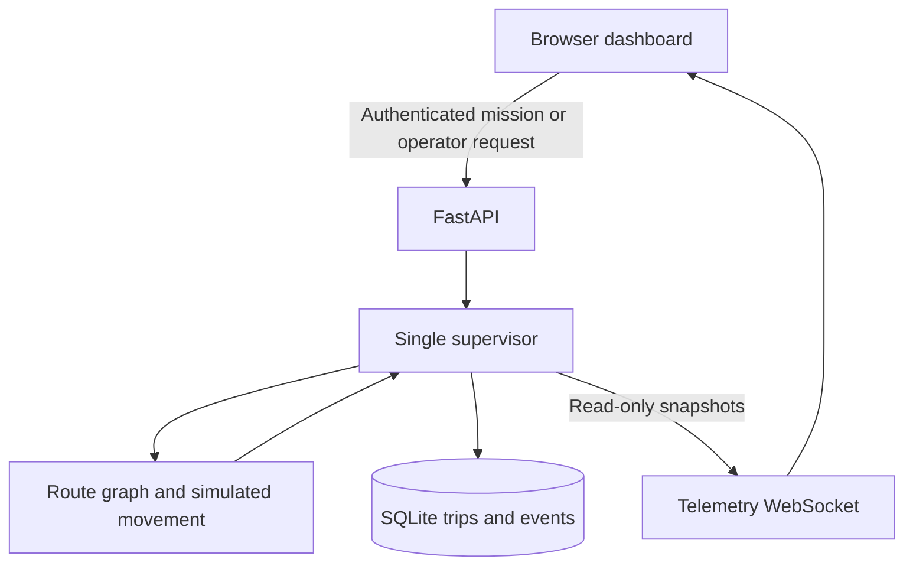
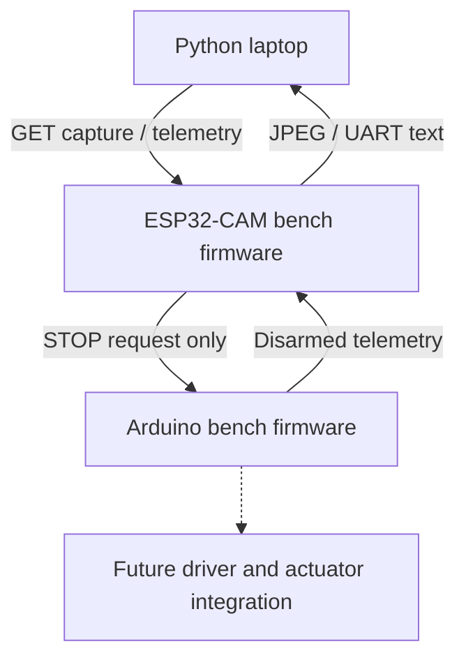

# Architecture and ownership

## Running laptop application

The FastAPI lifespan creates one Store and one Supervisor. A 20 Hz asynchronous task advances simulation; a read-only WebSocket publishes snapshots at 5 Hz. Request handlers do not await while mutating the core, so mutations are serialized on the event loop. SQLite writes are synchronous and suitable only for this small prototype; a storage error faults motion in memory. A blocked event loop faults an active simulation when its next tick exceeds the configured timing window.

The graph coordinates are virtual metres; A, B and C are stops and J is a junction. A shortest graph route is selected before simulation begins. This version follows ideal geometry; it has no vehicle dynamics, acceleration model, learned perception, lane detection or physical localization.

## States

- READY: no movement; permits a mission only at a named stop with healthy inputs.
- ACTIVE: one trip owns the simulated vehicle.
- COMPLETE: destination reached; zero speed and terminal COMPLETED trip.
- STOPPED: operator stop/cancel; zero speed and CANCELLED trip.
- FAULT: latched obstacle, stale sensor, lost link, timing or supervisor exception.

Clearing a fault input never resumes movement. Explicit rearm returns READY. If stopped between stops, a simulation reset is required before a new trip. Reset is rejected while ACTIVE. No equivalent physical teleport/reset is implied.

## Hardware direction (not integrated with driving)

ESP32 exposes authenticated `/capture`, `/telemetry`, and `/stop` on local HTTP. There is no command stream, continuous MJPEG or motion endpoint yet. Python camera_probe tests one image. The application simulator is intentionally independent of the board starters.

Camera work must eventually run outside the supervisor loop with bounded latest-frame queues. A real adapter must preserve freshness through every hop, reject replay, separate acknowledgements from measured stopping, and leave Arduino safety independent of the host.

## Access and deployment

All mutation and history/event endpoints require the configured bearer token. Public status, stop definitions, API documentation and the read-only WebSocket are appropriate only for the loopback development instance. Tokens are a development operator mechanism, not passenger account management. The browser keeps its entered token in memory only.

Before LAN deployment: implement appropriate role-based access, protect telemetry and documentation, use TLS and device authentication, restrict origin/host access, and protect against connection flooding. Do not expose this development service directly to the internet.

## Sources

- FastAPI WebSockets: https://fastapi.tiangolo.com/advanced/websockets/
- Espressif camera API: https://github.com/espressif/esp32-camera
- PlatformIO AI Thinker target: https://docs.platformio.org/en/latest/boards/espressif32/esp32cam.html
